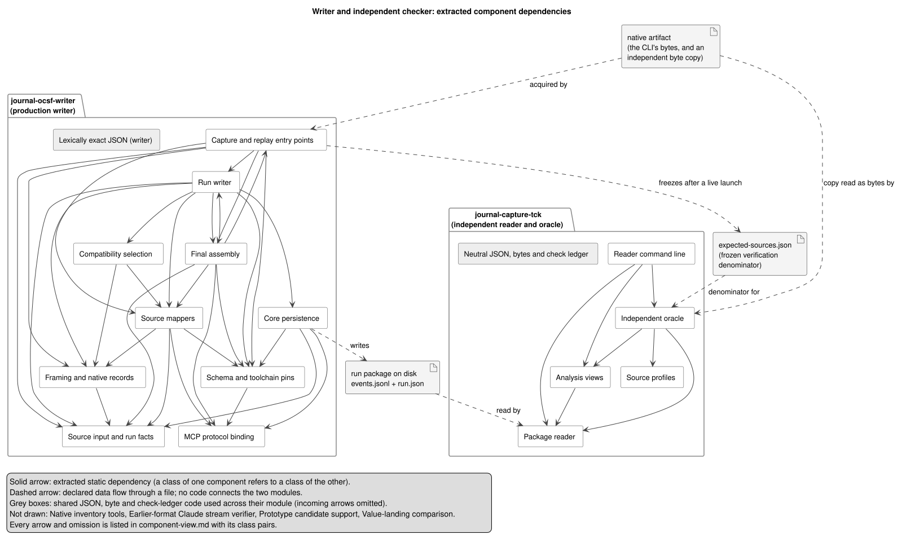
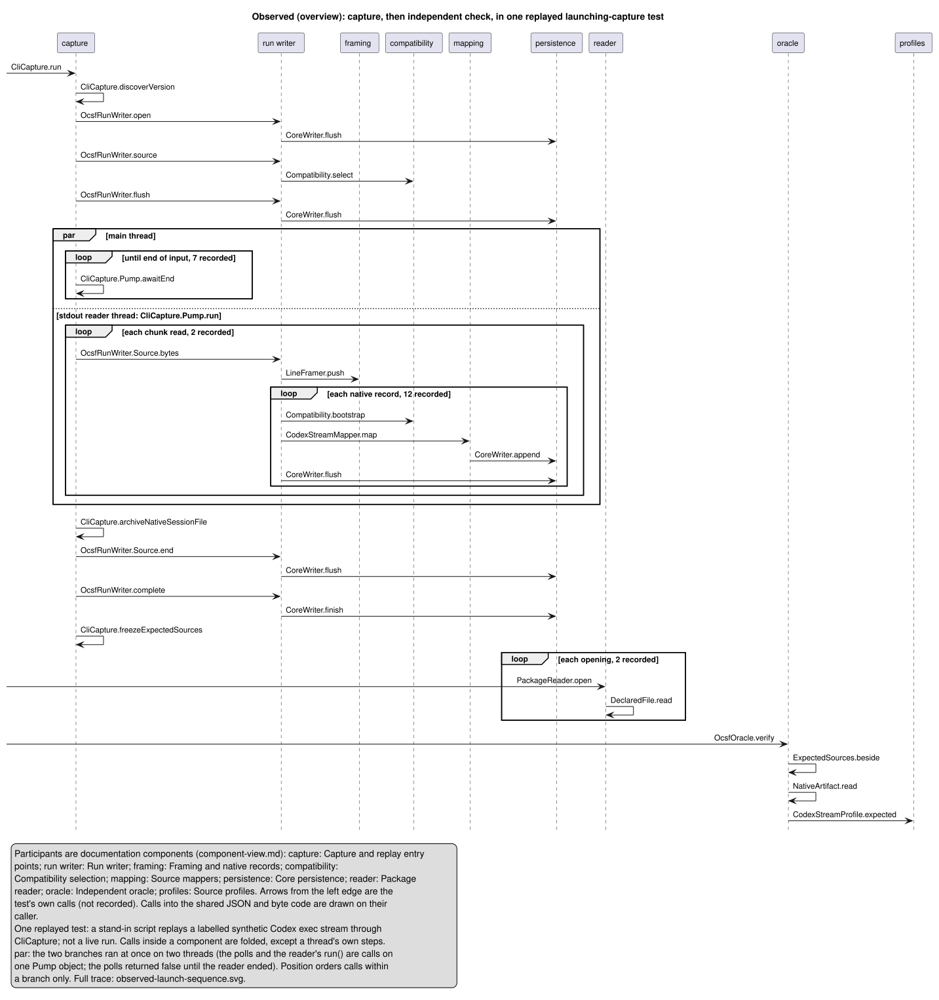

# Agent Journal architecture guide: the OCSF writer and its independent checker

This guide explains the OCSF-based writer (`journal-ocsf-writer`) and the independent reader and oracle that judge it
(`journal-capture-tck`, the TCK: the project's compatibility kit of reader, oracle and tools). It is written for a capable colleague who does not know the code. The older `journal-core` and
`<cli>-capture` modules are out of scope. Both modules here are **non-production prototypes**: the event file layout is
`0.3.0-prototype`, on OCSF 1.9.0 with the `agentic_cli` extension `0.9.0-prototype` (provisional, unregistered uid 901). No
production default uses them.

Every statement carries one of these labels:

| Label | Meaning | Where it comes from |
|---|---|---|
| **declared design** | what the code is meant to do | class documentation, the [requirements](../../journal-capture-tck/src/test/resources/requirements/agent-journal/rules.md), contracts |
| **declared policy** | a dependency the build forbids | [`ArchitectureBoundaryTest`](../../journal-ocsf-writer/src/test/java/io/github/markpollack/journal/architecture/ArchitectureBoundaryTest.java) |
| **extracted structure** | references that exist in the compiled classes | [`ComponentViewTest`](../../journal-ocsf-writer/src/test/java/io/github/markpollack/journal/architecture/ComponentViewTest.java), generated |
| **observed execution** | calls recorded while one test ran | an AppMap recording, generated |
| **executed example** | a committed input through the saved output and this build's checks | [`ToolCallStoryTest`](../../journal-capture-tck/src/test/java/io/github/markpollack/journal/tck/ocsf/ToolCallStoryTest.java), generated |
| **proposed** | reviewed meaning that awaits approval | the mapping catalog's claim records |

## 1. The system on one page

**Problem.** AI coding CLIs (Claude Code, Codex CLI and others) report their activity in vendor-specific streams. Journal
records what one CLI run reported as `events.jsonl`, a portable file that another program can interpret without Journal's
code. Vendor detail it cannot yet map is kept, not dropped.

**Boundary** (declared design). Journal records explicit tool invocations and the observations the CLI reports. A shell
command containing `grep` or a pipe is one invocation; Journal derives no extra calls from command text. Live capture reads
the stream the CLI offers. The CLI's own saved session file is archived unchanged and never parsed to enrich the stream.

**Key mechanism: two independent readings of the same bytes.** The writer maps each native record into OCSF events as it
arrives. Separately, the TCK's source profiles read the same native bytes and state what they report. The oracle then
compares the saved file with those statements, record by record. The two modules share no production code; they meet only
in files. (The writer's tests use the TCK to judge it; that is test scope only.)



*Extracted structure, drawn from the compiled classes. Every component and solid arrow resolves to classes and class pairs
in [component-view.md](generated/component-view.md). The dashed arrows and the three files are declared data flows, each
taken from the documentation of the class named in [component-view.json](generated/component-view.json).*

**Main trade-off.** Interpretation is written twice per CLI, once as the writer's mapper and once as the oracle's profile.
That duplication is deliberate: "a checker built from the code it checks cannot disagree with it" (RULE-29). The cost is two
implementations to maintain, and they can still share a wrong premise. Reviewed examples, authored from the CLI's own pinned
source, are a third reading that challenges both.

**Reading path.** Section 2 separates the two flows. Section 3 covers the structure and its enforced boundary, section 4 one
observed run, and section 5 one tool call from start to finish. Sections 6 to 8 cover contracts, rationale and where to make
changes.

## 2. Two flows, kept apart

| Flow | Question it answers | Evidence |
|---|---|---|
| Define and review a common meaning | Why does a saved field mean this, and why does this CLI's field bind to it? | Foundation inventories, pinned CLI source references, claims, reviewed examples and counterexamples in the [mapping catalog](../../journal-capture-tck/src/test/resources/ocsf/mapping-catalog/) |
| Record and verify one execution | How did these native bytes become these saved events, and does an independent reading agree? | Compiled code, fixtures, saved packages, oracle reports |

A call trace cannot show why a definition was chosen, and a design narrative cannot show which branch a run took. The
[tool-call story](generated/tool-call-story.md) crosses from the first flow to the second for one call.

## 3. Module view: responsibilities and the enforced boundary

**Question:** which code owns capture, mapping, persistence and independent checking, and what may depend on what?

The diagram above groups the 84 top-level production classes of both modules into 19 components; 15 are drawn. The grouping
([`ArchitectureComponents`](../../journal-ocsf-writer/src/test/java/io/github/markpollack/journal/architecture/ArchitectureComponents.java))
is a design judgment made once. It uses package roots, implementations of `SourceMapper` and `SourceProfile`, and short
explicit lists. A test fails when a class belongs to no component or to two. The responsibility of each component is in
[component-view.md](generated/component-view.md).

On the writer side, the capture entry points feed bytes into the run writer. The run writer frames them, selects the
compatibility entry, and hands each record to the source's mapper. Core persistence appends the resulting events and
declarations. On the checker side, the oracle uses the package reader, the source profiles and the analysis views. Both
sides rest on their own JSON code: the writer's `Jv`, the TCK's `NeutralJson`.

**Declared policy versus extracted structure.** The arrows show what the code depends on today. The rules below state what
it may depend on. Rules 1 to 3 restate design the project had already documented; rule 4 is a judgment added with this guide.
None was read off the graph: a rule generated from the same code would only confirm the status quo. That today's classes
satisfy the rules is a check result, not the source of the rules. The "oracle core" in rule 2 is every class of the
`tck.ocsf` package apart from its command-line tool: the reader, oracle, profiles and views.

| Rule (declared policy) | Source of the rule | Executable check |
|---|---|---|
| 1. The TCK's production code uses only the JDK, Jackson and itself: no writer, capture, SDK or legacy-core class | RULE-29 (the TCK must not call production parsers, SDK deserializers or mappers to compute expected values); the writer's POM (the TCK "reads its output and never calls it") | `theCheckerDependsOnNoProducerCode` |
| 2. The oracle core uses neither Jackson data binding nor the `tck.ocsf.prototype` support that produces candidate packages | `OcsfOracle` ("the checking path is this package plus `Json`/`NeutralJson`; it never calls the Python prototype, a production parser or a generated model"); `PrototypeRepackager` ("the oracle never calls it"); `NeutralJson` (tokenizer only) | `theOracleCoreReadsNativeBytesNeutrally` |
| 3. The writer's production code uses only the JDK, Jackson's tokenizer and itself | `Jv` (Jackson's tokenizer only; no production DTO or vendor type in the writer); the writer's POM (the TCK is a test dependency "main code never depends on") | `theWriterDependsOnlyOnItselfAndTheJacksonTokenizer` |
| 4. The TCK's packages have no cycles | a judgment added with this guide: it keeps the neutral JSON and check ledger below the oracle | `theCheckersPackagesAreFreeOfCycles` |

Each rule's selection is asserted to contain the intended classes, so a renamed package cannot make a rule pass vacuously.
Two negative controls in test sources show that the rules reject a forbidden dependency. One parses native lines with the
writer's `Jv`; the other binds them with Jackson data binding. Limits: the rules see direct bytecode references only.
Reflection, service loading, process invocation and reuse through data need other controls.

**An observation from the extraction.** The arrow from *capture* to *source mappers* is one extracted class pair,
`CliCapture -> MapperSupport`. Reading the source explains it. After a live launch, `CliCapture.freezeExpectedSources`
writes `expected-sources.json`. That manifest is the oracle's denominator: the list of sources, and of child cores (the
separate cores the writer opens for a sub-agent's records), that the oracle must judge. The method hashes and counts the
independent byte copy, not the package. Three of its inputs, however, come from the writer side:

- On a Claude stream launch, the expected child cores are read from the copy with the writer's `Jv` parser and the mappers'
  `MapperSupport.text` (`parent_tool_use_id`).
- Whether the run is expected complete is derived from the writer's final state.
- A no-match compatibility expectation is taken from the writer's own compatibility declarations.

`ExpectedSources` documents the manifest as "not derived from the candidate". For launched captures that holds for the bytes
but not for these three facts. Committed fixtures carry their own committed manifests. This is an **open, bounded
independence issue**, kept for the capture work it concerns. It is not evidence that any stored recording is wrong, and it
has not been repaired.

## 4. Component-and-connector view: one observed run

**Question:** what does one capture-then-check scenario actually call, and in what order?



*Observed execution, overview. The calls of one existing test, drawn between the components of section 3. The test is
[`CliCaptureTest#codexVersionIsDiscoveredOnceByTheDocumentedCommandAndTheThreadIdBecomesTheSession`](../../journal-ocsf-writer/src/test/java/io/github/markpollack/journal/ocsf/writer/CliCaptureTest.java).
A stand-in shell script replays the labelled synthetic 12-record Codex exec stream `syn-codex-exec-stream` through the
launching capture; the test then opens the package and runs the oracle. This is not a live CLI run, and it shows one path,
not every path. Only the entry methods listed in [`appmap.yml`](../../scripts/architecture/appmap.yml) were recorded.
[`sequence-overview.py`](../../scripts/architecture/sequence-overview.py) derives this overview from the same recording and
the same component membership. Its header states the rules: calls inside a component are folded, repeated blocks become
counted loops, and the reader thread is drawn as a `par` branch. Each message in the source names the recorded calls behind
it. The [full recorded trace](generated/observed-launch-sequence.svg), one lifeline per class, is the linked detail.*

What the recording shows:

- `CliCapture.run` discovers the version once, opens the writer, declares the source (which selects the compatibility entry)
  and flushes. It then polls `awaitEnd` while a separate reader thread (`CliCapture.Pump.run`) reads the CLI's standard
  output.
- On the reader thread, the stream arrives in read chunks. Each chunk is framed into lines, and for each record: the
  compatibility bootstrap check (`Compatibility.bootstrap`), `CodexStreamMapper.map`, `CoreWriter.append`, then a flush. By
  declared design the package is a readable prefix after each flush.
- The two threads ran at the same time. The main thread's polls and the reader's `run()` are calls on one `Pump` object, and
  the polls returned `false` until the reader ended
  ([observed-launch-recording.json](generated/observed-launch-recording.json)). Neither diagram orders calls across threads.
  The overview's `par` makes the concurrency explicit, and the detailed export's stacked thread blocks are layout, not time.
  AppMap's event ids are no reliable order across threads either: one recording assigned the same id on both threads.
- After end of input the capture archives the native session file, ends the source and completes the run through
  `CoreWriter.finish`, which by declared design hashes what is on disk. It then freezes `expected-sources.json`.
- The test opens the package (`PackageReader`, `DeclaredFile`). `OcsfOracle.verify` reads the expected-sources manifest, then
  the native copy as bytes (`NativeArtifact`), then asks `CodexStreamProfile` for the expected facts. No recorded writer method appears in this phase. That the checker
  cannot call the writer at all is the boundary rules' job (section 3), not this recording's, which sees only listed methods.

The detailed trace names classes; this is how they map onto the overview's components:

| Participant in the detailed trace | Component in section 3 |
|---|---|
| `CliCapture`, `CliCapture$Pump` | Capture and replay entry points |
| `OcsfRunWriter`, `OcsfRunWriter$Source` | Run writer |
| `LineFramer` | Framing and native records |
| `Compatibility` | Compatibility selection |
| `CodexStreamMapper` | Source mappers |
| `CoreWriter` | Core persistence |
| `PackageReader`, `DeclaredFile` | Package reader |
| `OcsfOracle`, `ExpectedSources` | Independent oracle |
| `NativeArtifact` | Neutral JSON, bytes and check ledger |
| `CodexStreamProfile` | Source profiles |

This AppMap trace is of the Java implementation running. It is a different population from the `events.jsonl` that Journal
writes about an agent's activity. The recording itself is not committed; its hash and size are in
[observed-launch-recording.json](generated/observed-launch-recording.json).

## 5. Executed example: one MCP tool call

**Question:** how does one native tool call become saved, checked facts, and what catches a wrong interpretation?

The full generated page is [tool-call-story.md](generated/tool-call-story.md). It is built from a sanitized live recording of
Codex CLI 0.160.1 calling a local MCP test server `fnd1`, replayed. In summary:

- Record 4, `item.started` for `mcp_tool_call` `item_1`, becomes *Tool Call: Started* (activity 4). `tool_name` is
  `echo_record` and `tool_namespace` is `fnd1`, kept apart. The arguments are saved exactly as `{"text":"fnd-1","n":7}`.
  `tool_call_uid` `item_1` has identity basis 2, a stream-local item id, which is not the model's call id. The kind is 99
  Other, because no reviewed binding of this server exists.
- No *Requested* event (activity 1) is written and no `response_uid` is set. This stream reports a started invocation, not
  the model's request.
- Record 5, `item.completed`, becomes *Result observed* (activity 2) under the same `item_1`. It keeps the text content and
  the structured result exactly, with status 1 (success). Record 7, the failing `always_fails`, has status 2 and
  `error_reported` true.
- Every saved event names the contract rule it executed. Every saved event also keeps the whole native record in `data`.

Two names can mislead here. The contract rule for the start is `codex.stream.mcp_tool_call->tool_call.requested`, and the
oracle checks it under `population.requests`. Both names cover the first observed stage of a tool call: the model's request
(activity 1) on routes that report one, a started invocation (activity 4) on this one. The oracle counts either as that
stage.

Against those saved values the page lists the reviewed example's expectation, field by field. It also shows the oracle's
verdict on the unchanged package, which has no defects. Then it applies each reviewed counterexample to a copy of the
package and runs the oracle again:

| Misleading interpretation | Check that catches it |
|---|---|
| `item_1` presented as the model's call id | `request.values`: identity basis 1 ≠ 2 |
| server folded into the name (`fnd1/echo_record`) | `request.values`: tool name differs |
| a failed call recorded as success | `result.values`: status 1 ≠ 2 |
| a model request invented from the started invocation | `population.requests`: `item_1` duplicated |

This summary is hand-written. The matching rows in tool-call-story.md are regenerated and checked by the build, and that
page is authoritative if they ever differ. What the example does not establish:
the two claims it cites are **proposed**, not approved. It covers one route and version (Codex exec stream, 0.160.1). It is a
replay, not a new live run.

## 6. Contracts and failure behaviour (declared design)

- **Input.** [`SourceInput`](../../journal-ocsf-writer/src/main/java/io/github/markpollack/journal/ocsf/writer/SourceInput.java)
  accepts byte chunks or whole records, each with the arrival time the caller observed, then `end(EOF|INTERRUPTED)`. The
  writer never substitutes its own clock for a source time.
- **Compatibility.** At most one registry entry
  ([`compatibility.json`](../../journal-ocsf-writer/src/main/resources/ocsf/compatibility.json)) applies to a source. A
  record that arrives without a usable selection is retained whole and flagged. That covers no match, a version not yet
  learned, and contradictory version assertions. It is never interpreted against the nearest entry.
- **Package states.** `RECORDING` (a consistent readable prefix after every flush), `COMPLETED`, `INTERRUPTED`, or `FAILED`
  (naming the last confirmed persisted boundary). Storage finalization, acquisition completeness and the CLI's exit are three
  separate facts.
- **Self-description.** `events.jsonl` declares its format, schema, run, contracts, sources and definitions before the first
  event that needs them. A reader needs only the file; `run.json` is an ancillary index.
- **Reader and oracle outcomes.** The reader refuses a package it cannot interpret safely (an unsupported version, a pin
  mismatch, a detached event file) but keeps its raw lines. Each oracle check is VERIFIED, REPRESENTATION_DIFFERS (equal
  values, a number spelled differently), DEFECTIVE, UNSUPPORTED, UNRESOLVED or NOT_APPLICABLE, counted separately with no
  single pass flag. `OcsfReaderTool verify` exits 0 only when the run is accepted. It exits 2 when the reader refused the
  package and 3 on a defect. It exits 4 when nothing is defective but the run is incomplete, a mandatory property is
  unresolved or unsupported, or no frozen manifest was supplied.

## 7. Rationale

- **Independent oracle.** Agreement between a writer and a checker that share code proves nothing (RULE-29). Two
  independently written readings can still share a wrong premise and agree. Structural rules cannot catch that, so reviewed,
  source-grounded examples and counterexamples challenge the mapper (`SemanticExampleTest`) and the profile
  (`SemanticExampleProfileTest`) separately.
- **Record what the source reports.** Source-reported values, declared derivations and Journal-generated values stay
  distinguishable. A value that holds only under an assumption is saved as conditional, never as an established quantity.
- **Stream first, archive unchanged** ([AGENTS.md](../../AGENTS.md)). Live capture normalizes the stream the CLI offers. The CLI's
  saved session file is archived with its checksum and never parsed to supplement the stream. Importing a saved session is a
  separate, explicitly requested offline mode with its own provenance.

## 8. Where to make a change

| Task | Where |
|---|---|
| Add a CLI route | A registry entry in `compatibility.json`, a mapping contract under `journal-ocsf-writer/src/main/resources/ocsf/mappings/`, a `SourceMapper` (registered in `SourceMapper.forProfile`), an independent `SourceProfile`, a sanitized fixture, and reviewed examples in the mapping catalog. The new mapper and profile fall into their components automatically through those interfaces; regenerate the view. |
| Change what a field means | The claim and reviewed example in the mapping catalog first, then the contract rule, the mapper and the profile, each separately |
| Investigate an oracle defect | The check's detail names the record and value. Compare the native record, the saved event's `data` and `journal.rule_uid`, and the profile's reading |
| Add a class | Its component in `ArchitectureComponents`, if no package or interface rule covers it; the build says so |

## 9. Regenerating and checking this guide

```bash
scripts/architecture-docs.sh            # component view and tool-call story, presentation checks, SVG rendering
scripts/architecture-docs.sh --appmap   # also re-records the observed run and derives the overview (opt-in)
scripts/architecture-docs.sh --docx     # also exports this guide and the tool-call story as one Word file
```

The normal build (`./mvnw clean verify`) runs the boundary rules and the membership check. It also fails while
`component-view.json`, `component-view.md`, `component-view.puml` or `tool-call-story.md` differ from what the current
classes, evidence and oracle yield. The AppMap recording is never part of the normal build or the default writer path.
Recordings stay under `target/` and are ignored by git. A new recording can differ in polling counts, read chunks and
timings. The detailed trace is normalized only by removing the exporter's remote theme include and elapsed times and by
writing participant declarations in PlantUML's `"Name" as Alias` order.

**Presentation checks.** Every run of the script checks the committed diagram sources:

- PlantUML's `-checkonly` syntax check on every `.puml`. It fails on a syntax error but accepts an unclosed block.
- [pumllint](https://github.com/fdurieux/pumllint) with one profile per diagram kind, failing on any finding of minor
  severity or above. It catches the unclosed block, undeclared or unused participants, unbalanced activations, unlabelled
  messages and blocks, and unpaired returns. The [overview profile](../../scripts/architecture/pumllint-overview.toml)
  also limits size (11 participants, 30 messages, 60 elements, default nesting depth) and allows self-messages only on the
  three orchestrating components. The [detail profile](../../scripts/architecture/pumllint-detail.toml) turns off the size
  limits and the self-message rule, because the trace records real self-calls. Both profiles turn off the inline-styling
  rule, since the generators own the styling, and set the naming pattern to the aliases each generator writes.
- The component view gets the syntax check only: pumllint 0.33.0 reads a component diagram as a sequence diagram, so its
  findings there would be noise.

These checks are not evidence of correctness or readability; inspect the SVGs and the Word export at reading size. The
overview is about 1,430 by 1,500 pixels: readable at full size in a browser, with the detailed trace linked for zooming. In
the Word export every diagram is fitted to the page width, so the sequence diagrams there need zoom. A landscape page does
not help, because the overview is as tall as it is wide.

Pinned tools: ArchUnit 1.5.0, PlantUML 1.2026.8 (rendering and syntax check, layout `smetana`), AppMap Java agent 1.30.2,
`@appland/appmap` 3.204.0, pumllint 0.33.0 (through `uvx`), pandoc for the Word export.

This prose is maintained by hand. Generated files carry a header saying so and are rewritten only by the commands above.
